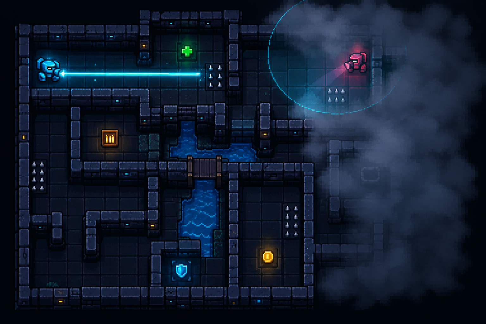

# Robot Arena


Robot de combat en Go pour le projet Arena (Ynov, Bachelor 1).

Le robot charge une carte `.map`, lit à chaque tour l'état envoyé par l'arbitre (TOUR, MOI, ENNEMI, OBJET… jusqu'à FIN), choisit une action et la renvoie sur la sortie standard. Il écrit aussi tout ce qu'il fait dans `partie.log`.

Il marche avec les trois versions du protocole :
- **v1** : déplacements et tirs ;
- **v2** : munitions et objets (soin, munitions, bouclier, trésor) ;
- **v3** : brouillard (on ne voit l'ennemi et les objets qu'à 4 cases) et radar.

On utilise seulement la bibliothèque standard de Go.

## Membres du groupe

- Quentin Guirlinger : protocole, IA
- Aryeh Henin : carte, journal

## Installation

Il faut Go installé. Dans le dossier du projet :

```
go build -o robot.exe .
```

(sous Linux ou macOS : `go build -o robot .`)

## Utilisation

Lancer une partie avec l'arbitre :

```
./arbitre --carte cartes/niveau1/arene.map --robot1 ./robot.exe --robot2 veteran --protocole 3 --manches 4
```

- `--protocole` : 1, 2 ou 3 ;
- `--robot2` : l'adversaire (`cible`, `bleu`, `chasseur` ou `veteran`) ;
- ajouter `--silencieux` pour n'avoir que les résultats.

Lancer les tests :

```
go test ./...
```

## Architecture

```
main.go          relie tout : options, chargement de la carte, boucle des tours
carte/           lit et vérifie les fichiers .map
protocole/       lit les blocs de l'arbitre et envoie la réponse
ia/              décide l'action
  grille.go      positions, directions, coût de chaque case
  chemin.go      calcul des chemins les moins chers
  ia.go          la stratégie
journal/         écrit partie.log
cartes/          nos deux cartes (Le Pont, L'Oasis)
tests/           tests des cartes, du protocole et de l'IA
```

| Package | Rôle |
|---|---|
| `carte` | Lit l'en-tête (NOM, DIFFICULTE, TOURS, TAILLE) et la grille. Refuse une carte fausse avec un message qui dit le fichier, la ligne, la colonne et le problème. |
| `protocole` | Transforme un bloc en `Etat`. Il ignore les lignes vides, les espaces en trop, les `\r` de Windows, les mots-clés et les champs inconnus. Un bloc mal formé est refusé et le robot répond `ATTENDS`. |
| `ia` | Choisit l'action à partir de l'état et de ce dont il se souvient des tours d'avant. |
| `journal` | Écrit une ligne par tour : position, PV, action et raison. Chaque ligne est écrite tout de suite, pour ne rien perdre si le robot est arrêté. |

`main.go` ne contient pas de logique : il lit, il demande à l'IA, il répond. Le robot ne plante jamais (pas de `panic`), et la sortie standard ne sert qu'aux actions.

## Notre IA

### Les chemins

On calcule le chemin le moins cher vers chaque case, pas juste le plus court. Chaque case a un coût :

| Case | Coût |
|---|---|
| sol | 1 |
| eau | 3 |
| piège | 4, ou 10 si on a 50 PV ou moins |
| piège avec 15 PV ou moins | interdit (il nous tuerait) |
| mur, hors de la carte | interdit |

Pour chaque case, on retient aussi le premier pas à faire depuis notre robot pour y aller. Pour aller quelque part, il suffit donc de regarder ce premier pas.

### Les décisions, dans l'ordre

À chaque tour, on prend la première règle qui marche :

1. **Tirer** si l'ennemi est aligné à 5 cases ou moins, sans mur entre nous.
2. **Radar** si on a perdu l'ennemi depuis trop longtemps (v3).
3. **Bouclier de notre côté** : aller chercher un bouclier si on y arrive avant l'ennemi.
4. **Tir anticipé** : on devine son prochain pas (il vient vers nous par le plus court chemin) et on tire sur cette case. S'il y entre, il est touché avant de pouvoir tirer.
5. **Soin** si on a 50 PV ou moins.
6. **Munitions** si on n'en a plus.
7. **Objet utile proche** (pas de soin si on a déjà presque tous nos PV).
8. **Se rapprocher** d'une case d'où on peut lui tirer dessus.

### L'embuscade

Les tirs sont simultanés : si on entre dans sa ligne de tir en même temps que lui, on s'échange 20 PV par tour et c'est souvent un match nul. Donc **on n'entre jamais le premier dans sa ligne de tir**. Si notre prochain pas est dans sa ligne (maintenant ou après son prochain pas), on attend qu'il entre dans la nôtre, et le tir anticipé le touche en premier.

On attend tant qu'il se rapproche, et au maximum 3 tours s'il ne se rapproche plus, pour ne pas attendre à l'infini.

Si on rate 2 tirs anticipés de suite, on arrête d'anticiper pendant 10 tours.

### Le brouillard (protocole v3)

En v3, l'arbitre n'envoie l'ennemi et les objets que s'ils sont à 4 cases ou moins. Le robot se souvient donc :
- de la **dernière position de l'ennemi** (au début, c'est sa case de départ) ;
- des **objets déjà vus**. Un objet à 4 cases ou moins qu'on ne voit plus a été ramassé, donc on l'oublie.

Quand on ne voit pas l'ennemi, **on devine qu'il avance d'un pas vers nous** à chaque tour, sans le mettre à moins de 5 cases (sinon on le verrait). Ça permet de garder l'embuscade même sans le voir.

Le **radar** fait passer un tour, mais au tour suivant on voit toute l'arène. On l'utilise :
- quand on ne l'a pas vu depuis 6 tours, ou quand il n'est plus là où on le croyait (au plus un radar tous les 10 tours) ;
- **à la place d'ATTENDS** pendant l'embuscade : les deux font passer le tour, mais le radar nous montre où il est.